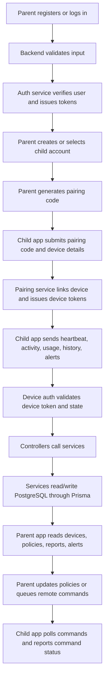

# Parental Control Backend API

This document describes the API routes currently registered in `src/routes/index.routes.js` and the behavior implemented by their controllers and middleware. There are **74 routes under `/api`**, plus the root `GET /` route. Where implementation and intended behavior differ, the current behavior is called out explicitly.

## 1. Run Locally

From the `backend` directory, configure the database/environment values expected by `src/config/dotenv.js`, then run:

```bash
npm install
npm run dev
```

The API listens on `PORT` from the environment. If `PORT` is not set, check `src/config/dotenv.js` for the configured default. Examples below use:

```text
http://localhost:5000
```

All request bodies and JSON responses use `application/json`. Express limits JSON request bodies to 1 MB. The API prefix is `/api` except for `GET /`.

## 2. Authentication

| Credential                | Header                                        | Used by                                                                                 |
| ------------------------- | --------------------------------------------- | --------------------------------------------------------------------------------------- |
| Parent/user access token  | `Authorization: Bearer <parent_access_token>` | Parent-management endpoints; some general user endpoints accept any authenticated user. |
| Child-device access token | `Authorization: Bearer <device_access_token>` | Child/device reporting, heartbeat, command polling, and device command status updates.  |

Access tokens are issued by login/pairing and are distinct from refresh tokens. Send refresh tokens in the JSON body to the relevant refresh/logout endpoints; do not use them as bearer tokens.

Role-restricted parent routes require the authenticated user to have role `PARENT`. User and device authentication are separate: a user token does not authenticate a child device, and a device token does not authenticate a parent.

## 3. Shared Response Conventions

Most successful endpoints return an envelope similar to:

```json
{
  "success": true,
  "message": "Operation completed",
  "data": {}
}
```

Some endpoints return fields such as `user`, `accessToken`, or `refreshToken` beside `success` and `message`, or omit `message`. Use the endpoint-specific examples below as the guide. List endpoints normally put an array in `data`.

Common errors:

```json
{
  "success": false,
  "message": "Validation failed",
  "errors": [{ "field": "email", "message": "Invalid email address" }]
}
```

| Status | Meaning                                                                                                                |
| ------ | ---------------------------------------------------------------------------------------------------------------------- |
| `400`  | Invalid request, invalid state, or validation failure.                                                                 |
| `401`  | Missing/invalid/expired user or device token, or invalid credentials.                                                  |
| `403`  | Wrong role, inactive/blocked device, or disallowed origin.                                                             |
| `404`  | Route or requested resource not found. Unmatched routes return `{"success":false,"message":"API endpoint not found"}`. |
| `409`  | Duplicate/conflicting resource, where the service reports conflicts explicitly.                                        |
| `500`  | Unhandled/database error. The global handler responds with `{"success":false,"message":"Internal server error"}`.      |

The global error handler does not expose internal details for status `500`. Some controllers handle errors themselves; therefore exact messages/statuses can vary by endpoint.

## 4. Endpoint Reference

`PARENT` means user bearer authentication plus the `PARENT` role. `USER` means user bearer authentication without a route-level parent-only restriction. `DEVICE` means child-device bearer authentication. `Public` means no authentication middleware is attached.

### Base and Health

| Method and path   | Auth   | Request | Success                                                                                            |
| ----------------- | ------ | ------- | -------------------------------------------------------------------------------------------------- |
| `GET /`           | Public | None    | `200` `{success, message}`                                                                         |
| `GET /api/health` | Public | None    | `200` `{success, status, database, time}`; database failure returns `500` and an unhealthy status. |

### Authentication

| Method and path                   | Auth   | Request                                   | Success                                                                                                                                   |
| --------------------------------- | ------ | ----------------------------------------- | ----------------------------------------------------------------------------------------------------------------------------------------- |
| `POST /api/auth/register`         | Public | JSON: `name`, `email`, `password`         | `201` `{success, message, user, accessToken, refreshToken}`                                                                               |
| `POST /api/auth/login`            | Public | JSON: `email`, `password`                 | `200` `{success, message, user, accessToken, refreshToken}` or MFA challenge `{success, message, mfaRequired, challengeToken, expiresIn}` |
| `POST /api/auth/mfa/verify-login` | Public | JSON: `challengeToken`, six-digit `token` | `200` `{success, message, user, accessToken, refreshToken}`                                                                               |
| `POST /api/auth/refresh`          | Public | JSON: `refreshToken`                      | `200` `{success, message, accessToken, refreshToken}`                                                                                     |
| `POST /api/auth/logout`           | Public | JSON: `refreshToken`                      | `200` `{success, message}`; revokes the matching refresh token.                                                                           |
| `GET /api/auth/me`                | USER   | None                                      | `200` `{success, user}`                                                                                                                   |
| `GET /api/auth/parent/me`         | PARENT | None                                      | `200` `{success, user}`                                                                                                                   |

### Device Pairing, Heartbeat, and Device Tokens

| Method and path                     | Auth   | Request                                                                                                                                 | Success                                                              |
| ----------------------------------- | ------ | --------------------------------------------------------------------------------------------------------------------------------------- | -------------------------------------------------------------------- |
| `POST /api/device-pairing/generate` | PARENT | JSON: `childId` (UUID)                                                                                                                  | `201` `{success, message, data:{pairingCode, expiresAt}}`            |
| `POST /api/device-pairing/complete` | Public | JSON: `pairingCode` (six digits), `deviceIdentifier`, `deviceName`, `platform` (`ANDROID` or `IOS`), optional `osVersion`, `appVersion` | `200` `{success, message, data:{device, accessToken, refreshToken}}` |
| `POST /api/device-heartbeat`        | DEVICE | No body                                                                                                                                 | `200` `{success, message, data}`                                     |
| `POST /api/device-refresh`          | Public | JSON: `refreshToken`                                                                                                                    | `200` `{success, message, accessToken, refreshToken}`                |
| `POST /api/device-logout`           | Public | JSON: `refreshToken`                                                                                                                    | `200` `{success, message}`                                           |

### Device Management and Permissions

| Method and path                                          | Auth   | Request                                                                       | Success                                                                                          |
| -------------------------------------------------------- | ------ | ----------------------------------------------------------------------------- | ------------------------------------------------------------------------------------------------ |
| `GET /api/devices`                                       | PARENT | None                                                                          | `200` `{success, message, data:[devices]}`                                                       |
| `GET /api/devices/:deviceId`                             | PARENT | Path: `deviceId`                                                              | `200` `{success, message, data:device}`                                                          |
| `PATCH /api/devices/:deviceId/status`                    | PARENT | Path: `deviceId`; JSON: `status` (`ACTIVE`, `OFFLINE`, `LOCKED`, or `PAUSED`) | `200` `{success, message, data:device}`                                                          |
| `DELETE /api/devices/:deviceId`                          | PARENT | Path: `deviceId`                                                              | `200` `{success, message, data:device}`; soft-removes the device by setting status to `REMOVED`. |
| `GET /api/devices/:deviceId/permissions`                 | PARENT | Path: `deviceId`                                                              | `200` `{success, message, data:[permissions]}`                                                   |
| `PATCH /api/devices/:deviceId/permissions/:permissionId` | PARENT | Path: `deviceId`, `permissionId`; JSON: boolean `allowed`                     | `200` `{success, message, data:permission}`                                                      |

Permission types are `CAMERA`, `MICROPHONE`, `LOCATION`, `STORAGE`, `CONTACTS`, `NOTIFICATIONS`, and `OTHER`.

### Permission Requests

| Method and path                                            | Auth   | Request                                                                                                           | Success                                     |
| ---------------------------------------------------------- | ------ | ----------------------------------------------------------------------------------------------------------------- | ------------------------------------------- |
| `POST /api/device/permission-requests`                     | DEVICE | JSON: `requestType` (`HARDWARE_PERMISSION`, `APPLICATION_ACCESS`, `DOMAIN_ACCESS`), `resource`, optional `reason` | `201` `{success, message, data:request}`    |
| `GET /api/device/my-permission-requests`                   | DEVICE | None                                                                                                              | `200` `{success, message, data:[requests]}` |
| `GET /api/device/permission-requests`                      | PARENT | None                                                                                                              | `200` `{success, message, data:[requests]}` |
| `PATCH /api/device/permission-requests/:requestId/approve` | PARENT | Path: `requestId`; no body                                                                                        | `200` `{success, message, data:request}`    |
| `PATCH /api/device/permission-requests/:requestId/reject`  | PARENT | Path: `requestId`; no body                                                                                        | `200` `{success, message, data:request}`    |

Request statuses are `PENDING`, `APPROVED`, `DENIED`, and `EXPIRED`. Approving a `HARDWARE_PERMISSION` request updates its matching database permission record, but does not itself grant an operating-system permission. Application/domain request approval changes request status; policy enforcement is a separate operation.

### Screen Time and Per-App Limits

| Method and path                                     | Auth   | Request                                                                                                                    | Success                                   |
| --------------------------------------------------- | ------ | -------------------------------------------------------------------------------------------------------------------------- | ----------------------------------------- |
| `GET /api/devices/:deviceId/screen-time-policy`     | PARENT | Path: `deviceId`                                                                                                           | `200` `{success, message, data:policy}`   |
| `POST /api/devices/:deviceId/screen-time-policy`    | PARENT | Path: `deviceId`; JSON: positive integer `dailyLimitMinutes`; optional `enabled`, `bedtimeStart`, `bedtimeEnd`, `timezone` | `201` `{success, message, data:policy}`   |
| `PATCH /api/devices/:deviceId/screen-time-policy`   | PARENT | Path: `deviceId`; JSON: one or more policy fields above                                                                    | `200` `{success, message, data:policy}`   |
| `GET /api/devices/:deviceId/app-limits`             | PARENT | Path: `deviceId`                                                                                                           | `200` `{success, message, data:[limits]}` |
| `POST /api/devices/:deviceId/app-limits`            | PARENT | Path: `deviceId`; JSON: `appIdentifier`, positive integer `limitMinutes`                                                   | `201` `{success, message, data:limit}`    |
| `PATCH /api/devices/:deviceId/app-limits/:limitId`  | PARENT | Path: `deviceId`, `limitId`; JSON: positive integer `limitMinutes`                                                         | `200` `{success, message, data:limit}`    |
| `DELETE /api/devices/:deviceId/app-limits/:limitId` | PARENT | Path: `deviceId`, `limitId`                                                                                                | `200` `{success, message}`                |

`bedtimeStart` and `bedtimeEnd` use `HH:mm` values (or `null` where supported). The policy timezone should be an IANA timezone such as `Asia/Dhaka`.

### App Usage and Device Activity

| Method and path                                 | Auth   | Request                                                                                                                 | Success                                          |
| ----------------------------------------------- | ------ | ----------------------------------------------------------------------------------------------------------------------- | ------------------------------------------------ |
| `POST /api/device/app-usage`                    | DEVICE | JSON: `appIdentifier`, ISO `startedAt`; optional ISO `endedAt`, integer `durationSeconds`                               | `201` `{success, message, data:usage}`           |
| `GET /api/devices/:deviceId/app-usage`          | PARENT | Path: `deviceId`                                                                                                        | `200` `{success, message, data:[usage records]}` |
| `GET /api/devices/:deviceId/app-usage/summary`  | PARENT | Path: `deviceId`                                                                                                        | `200` `{success, message, data:summary}`         |
| `POST /api/device/activity`                     | DEVICE | JSON: `activityType`, ISO `capturedAt`; optional `foregroundApp`, paired numeric `latitude` and `longitude`, `metadata` | `201` `{success, message, data:activity}`        |
| `GET /api/devices/:deviceId/activities`         | PARENT | Path: `deviceId`                                                                                                        | `200` `{success, message, data:[activities]}`    |
| `GET /api/devices/:deviceId/activities/summary` | PARENT | Path: `deviceId`                                                                                                        | `200` `{success, message, data:summary}`         |

Activity types include `APP_LAUNCH`, `APP_CLOSE`, `DEVICE_ONLINE`, `DEVICE_OFFLINE`, `SCREEN_LOCK`, `SCREEN_UNLOCK`, `POLICY_VIOLATION`, `LOCATION_UPDATE`, and `OTHER`. App usage end time must not be earlier than start time.

### Remote Commands

| Method and path                                | Auth   | Request                                                                                                                                | Success                                     |
| ---------------------------------------------- | ------ | -------------------------------------------------------------------------------------------------------------------------------------- | ------------------------------------------- |
| `POST /api/devices/:deviceId/commands`         | PARENT | Path: `deviceId`; JSON: `commandType` (`LOCK`, `UNLOCK`, `PAUSE`, `RESUME`, `SYNC_POLICY`), optional `payload`, future ISO `expiresAt` | `201` `{success, message, data:command}`    |
| `GET /api/device/commands`                     | DEVICE | None                                                                                                                                   | `200` `{success, message, data:[commands]}` |
| `PATCH /api/device/commands/:commandId/status` | DEVICE | Path: `commandId`; JSON status `SENT`, `ACKNOWLEDGED`, or `FAILED`                                                                     | `200` `{success, message, data:command}`    |
| `GET /api/devices/:deviceId/commands`          | PARENT | Path: `deviceId`                                                                                                                       | `200` `{success, message, data:[commands]}` |

Command statuses also include `PENDING` and `EXPIRED`; the child status-update endpoint accepts only `SENT`, `ACKNOWLEDGED`, and `FAILED`.

### DNS Policy and Domain Rules

| Method and path                                                 | Auth   | Request                                                                                          | Success                                  |
| --------------------------------------------------------------- | ------ | ------------------------------------------------------------------------------------------------ | ---------------------------------------- |
| `POST /api/devices/:deviceId/dns-policy`                        | PARENT | Path: `deviceId`; optional `enabled`, `provider`, URL `dohEndpoint`, `dotEndpoint`, `safeSearch` | `201` `{success, message, data:policy}`  |
| `GET /api/devices/:deviceId/dns-policy`                         | PARENT | Path: `deviceId`                                                                                 | `200` `{success, message, data:policy}`  |
| `PATCH /api/devices/:deviceId/dns-policy`                       | PARENT | Path: `deviceId`; one or more DNS policy fields above                                            | `200` `{success, message, data:policy}`  |
| `POST /api/devices/:deviceId/dns-policy/domain-rules`           | PARENT | Path: `deviceId`; JSON: `domain`, `action` (`ALLOW` or `BLOCK`), optional UUID/null `categoryId` | `201` `{success, message, data:rule}`    |
| `GET /api/devices/:deviceId/dns-policy/domain-rules`            | PARENT | Path: `deviceId`                                                                                 | `200` `{success, message, data:[rules]}` |
| `PATCH /api/devices/:deviceId/dns-policy/domain-rules/:ruleId`  | PARENT | Path: `deviceId`, `ruleId`; one or more rule fields above                                        | `200` `{success, message, data:rule}`    |
| `DELETE /api/devices/:deviceId/dns-policy/domain-rules/:ruleId` | PARENT | Path: `deviceId`, `ruleId`                                                                       | `200` `{success, message}`               |

### Domain Categories and App Policies

| Method and path                                        | Auth   | Request                                                                                                  | Success                                                                        |
| ------------------------------------------------------ | ------ | -------------------------------------------------------------------------------------------------------- | ------------------------------------------------------------------------------ |
| `POST /api/domain-categories`                          | PARENT | JSON: `name`, `slug`, optional `description`                                                             | `201` `{success, message, data:category}`                                      |
| `GET /api/domain-categories`                           | PARENT | None                                                                                                     | `200` `{success, message, data:[categories]}`                                  |
| `GET /api/domain-categories/:categoryId`               | PARENT | Path: `categoryId`                                                                                       | `200` `{success, message, data:category}`                                      |
| `PATCH /api/domain-categories/:categoryId`             | PARENT | Path: `categoryId`; one or more of `name`, `slug`, `description`                                         | `200` `{success, message, data:category}`                                      |
| `DELETE /api/domain-categories/:categoryId`            | PARENT | Path: `categoryId`                                                                                       | `200` `{success, message}`                                                     |
| `POST /api/devices/:deviceId/app-policies`             | PARENT | Intended JSON: `appIdentifier`, optional `appName`, `decision` (`ALLOW` or `BLOCK`), optional `category` | Intended `201` `{success, message, data:policy}`; see validation caveat below. |
| `GET /api/devices/:deviceId/app-policies`              | PARENT | Path: `deviceId`                                                                                         | `200` `{success, message, data:[policies]}`                                    |
| `PATCH /api/devices/:deviceId/app-policies/:policyId`  | PARENT | Path: `deviceId`, `policyId`; intended JSON: one or more app policy fields                               | Intended `200` `{success, message, data:policy}`; see validation caveat below. |
| `DELETE /api/devices/:deviceId/app-policies/:policyId` | PARENT | Path: `deviceId`, `policyId`                                                                             | `200` `{success, message}`                                                     |

**Known validation issue:** The shared `validate()` middleware parses `req.body`, while the app-policy schemas wrap their fields under a `body` property and the controller reads fields from the top-level body. As currently implemented, normal flat request JSON for app-policy create/update fails validation; nesting fields under `body` does not match the controller's expected shape. This needs a backend fix before those write endpoints can work normally.

### Browser History, Security Alerts, Notifications, and Location

| Method and path                                 | Auth   | Request                                                                                     | Success                                            |
| ----------------------------------------------- | ------ | ------------------------------------------------------------------------------------------- | -------------------------------------------------- |
| `POST /api/device/browser-history`              | DEVICE | JSON: `url`, `domain`, ISO `visitedAt`; optional `pageTitle`, boolean `blocked`, `category` | `201` `{success, message, data:historyRecord}`     |
| `GET /api/devices/:deviceId/browser-history`    | PARENT | Path: `deviceId`                                                                            | `200` `{success, message, data:[history records]}` |
| `POST /api/device/alerts`                       | DEVICE | JSON: `type`, `title`; optional `severity`, `description`, `metadata`                       | `201` `{success, message, data:alert}`             |
| `GET /api/alerts`                               | PARENT | None                                                                                        | `200` `{success, message, data:[alerts]}`          |
| `GET /api/alerts/:alertId`                      | PARENT | Path: `alertId`                                                                             | `200` `{success, message, data:alert}`             |
| `PATCH /api/alerts/:alertId/acknowledge`        | PARENT | Path: `alertId`; no body                                                                    | `200` `{success, message, data:alert}`             |
| `GET /api/notifications`                        | USER   | None                                                                                        | `200` `{success, message, data:[notifications]}`   |
| `GET /api/notifications/:notificationId`        | USER   | Path: `notificationId`                                                                      | `200` `{success, message, data:notification}`      |
| `PATCH /api/notifications/:notificationId/read` | USER   | Path: `notificationId`; no body                                                             | `200` `{success, message, data:notification}`      |
| `PATCH /api/notifications/read-all`             | USER   | No body                                                                                     | `200` `{success, message, data}`                   |
| `GET /api/devices/:deviceId/location`           | PARENT | Path: `deviceId`                                                                            | `200` `{success, message, data:location}`          |
| `GET /api/devices/:deviceId/location/history`   | PARENT | Path: `deviceId`                                                                            | `200` `{success, message, data:[locations]}`       |

Alert types include `PROHIBITED_APP_LAUNCH`, `APP_INSTALL_ATTEMPT`, `PROHIBITED_DOMAIN`, `MALWARE_DETECTED`, `PHISHING_DETECTED`, `ROOT_DETECTED`, `TAMPER_DETECTED`, `DEVICE_OFFLINE`, `SCREEN_TIME_EXCEEDED`, `BEDTIME_VIOLATION`, `PERMISSION_REQUEST`, and `OTHER`. Severity values are `LOW`, `MEDIUM`, `HIGH`, and `CRITICAL`.

### MFA and Audit Logs

| Method and path              | Auth   | Request                                                                                | Success                                                                                                         |
| ---------------------------- | ------ | -------------------------------------------------------------------------------------- | --------------------------------------------------------------------------------------------------------------- |
| `POST /api/auth/mfa/setup`   | PARENT | No body                                                                                | `200` `{success, message, data:{qrCode, secret, ...}}`                                                          |
| `POST /api/auth/mfa/enable`  | PARENT | Intended JSON: six-digit `token`                                                       | Intended `200` `{success, message, data}`; see validation caveat below.                                         |
| `GET /api/auth/mfa/status`   | PARENT | No body                                                                                | `200` `{success, data:{enabled, confirmedAt}}`                                                                  |
| `POST /api/auth/mfa/disable` | PARENT | Intended JSON: `password`, six-digit `token`                                           | Intended `200` `{success, message, data:{enabled, message}}`; see validation caveat below.                      |
| `GET /api/audit-logs`        | PARENT | Intended query: optional `deviceId`, `action`, `startDate`, `endDate`, `page`, `limit` | Intended `200` `{success, data:{logs, pagination:{total,page,limit,totalPages}}}`; see validation caveat below. |

**Known validation issue:** MFA enable/disable validators wrap expected values under `body`, but `validate()` parses the top-level JSON body and the handlers read top-level fields. Normal flat JSON therefore fails validation. The audit-log route validates a schema expecting a nested `query` under the request body, while clients send query parameters and the handler reads `req.query`; the normal `GET /api/audit-logs?page=1&limit=20` request currently fails validation. These are implementation mismatches, not required client-side request formats.

## 5. Demo Requests and Responses

The examples use placeholder IDs and tokens. Replace them with values issued by your running backend. Response IDs, timestamps, messages, and nested resource fields can vary with the database records.

### Register and Log In

```bash
curl -X POST http://localhost:5000/api/auth/register \
  -H 'Content-Type: application/json' \
  -d '{"name":"Demo Parent","email":"parent@example.com","password":"DemoPass123!"}'
```

Representative response (`201`):

```json
{
  "success": true,
  "message": "Registration successful",
  "user": {
    "id": "b1cb1a55-03db-4e84-9cb6-d2771e0f9f11",
    "name": "Demo Parent",
    "email": "parent@example.com",
    "role": "PARENT",
    "status": "ACTIVE"
  },
  "accessToken": "<parent_access_token>",
  "refreshToken": "<parent_refresh_token>"
}
```

Login request:

```bash
curl -X POST http://localhost:5000/api/auth/login \
  -H 'Content-Type: application/json' \
  -d '{"email":"parent@example.com","password":"DemoPass123!"}'
```

Successful login returns the user and access/refresh tokens. If MFA is enabled, login instead returns `mfaRequired`, `challengeToken`, and `expiresIn`; send the challenge token and the current six-digit authenticator code to `POST /api/auth/mfa/verify-login`.

### Generate a Pairing Code and Pair a Device

Generate a code as the parent:

```bash
curl -X POST http://localhost:5000/api/device-pairing/generate \
  -H 'Authorization: Bearer <parent_access_token>' \
  -H 'Content-Type: application/json' \
  -d '{"childId":"b1cb1a55-03db-4e84-9cb6-d2771e0f9f22"}'
```

Representative response (`201`):

```json
{
  "success": true,
  "message": "Pairing code generated successfully",
  "data": {
    "pairingCode": "482913",
    "expiresAt": "2026-11-09T12:15:00.000Z"
  }
}
```

Complete pairing from the child app (no bearer token is used for this request):

```bash
curl -X POST http://localhost:5000/api/device-pairing/complete \
  -H 'Content-Type: application/json' \
  -d '{"pairingCode":"482913","deviceIdentifier":"android-demo-001","deviceName":"Demo Android","platform":"ANDROID","osVersion":"15","appVersion":"1.0.0"}'
```

Representative response (`200`):

```json
{
  "success": true,
  "message": "Device paired successfully",
  "data": {
    "device": {
      "id": "b1cb1a55-03db-4e84-9cb6-d2771e0f9f33",
      "deviceName": "Demo Android",
      "platform": "ANDROID",
      "status": "ACTIVE"
    },
    "accessToken": "<device_access_token>",
    "refreshToken": "<device_refresh_token>"
  }
}
```

### Create a Screen-Time Policy

```bash
curl -X POST http://localhost:5000/api/devices/<device_id>/screen-time-policy \
  -H 'Authorization: Bearer <parent_access_token>' \
  -H 'Content-Type: application/json' \
  -d '{"dailyLimitMinutes":120,"enabled":true,"bedtimeStart":"21:00","bedtimeEnd":"07:00","timezone":"Asia/Dhaka"}'
```

Representative response (`201`):

```json
{
  "success": true,
  "message": "Screen time policy created successfully",
  "data": {
    "deviceId": "<device_id>",
    "dailyLimitMinutes": 120,
    "enabled": true,
    "bedtimeStart": "21:00",
    "bedtimeEnd": "07:00",
    "timezone": "Asia/Dhaka"
  }
}
```

### Record App Usage from a Child Device

```bash
curl -X POST http://localhost:5000/api/device/app-usage \
  -H 'Authorization: Bearer <device_access_token>' \
  -H 'Content-Type: application/json' \
  -d '{"appIdentifier":"com.example.reader","startedAt":"2026-11-09T08:00:00.000Z","endedAt":"2026-11-09T08:25:00.000Z","durationSeconds":1500}'
```

Representative response (`201`):

```json
{
  "success": true,
  "message": "App usage recorded successfully",
  "data": {
    "id": "<usage_id>",
    "appIdentifier": "com.example.reader",
    "startedAt": "2026-11-09T08:00:00.000Z",
    "endedAt": "2026-11-09T08:25:00.000Z",
    "durationSeconds": 1500
  }
}
```

### Create a Domain Rule

```bash
curl -X POST http://localhost:5000/api/devices/<device_id>/dns-policy/domain-rules \
  -H 'Authorization: Bearer <parent_access_token>' \
  -H 'Content-Type: application/json' \
  -d '{"domain":"example.com","action":"BLOCK"}'
```

Representative response (`201`):

```json
{
  "success": true,
  "message": "Domain rule created successfully",
  "data": {
    "id": "<rule_id>",
    "domain": "example.com",
    "action": "BLOCK",
    "categoryId": null
  }
}
```

### Queue a Remote Command and Poll from Device

Parent creates a command:

```bash
curl -X POST http://localhost:5000/api/devices/<device_id>/commands \
  -H 'Authorization: Bearer <parent_access_token>' \
  -H 'Content-Type: application/json' \
  -d '{"commandType":"SYNC_POLICY","payload":{"reason":"parent_update"}}'
```

The child app fetches its pending commands:

```bash
curl http://localhost:5000/api/device/commands \
  -H 'Authorization: Bearer <device_access_token>'
```

Representative poll response (`200`):

```json
{
  "success": true,
  "message": "Pending commands fetched successfully",
  "data": [
    {
      "id": "<command_id>",
      "commandType": "SYNC_POLICY",
      "status": "PENDING",
      "payload": { "reason": "parent_update" }
    }
  ]
}
```

After processing, the device reports status with `PATCH /api/device/commands/<command_id>/status` and body `{"status":"ACKNOWLEDGED"}`.

### Request a Permission from the Child App

```bash
curl -X POST http://localhost:5000/api/device/permission-requests \
  -H 'Authorization: Bearer <device_access_token>' \
  -H 'Content-Type: application/json' \
  -d '{"requestType":"HARDWARE_PERMISSION","resource":"CAMERA","reason":"Need to join a class"}'
```

Representative response (`201`):

```json
{
  "success": true,
  "message": "Permission request created successfully",
  "data": {
    "id": "<request_id>",
    "requestType": "HARDWARE_PERMISSION",
    "resource": "CAMERA",
    "reason": "Need to join a class",
    "status": "PENDING"
  }
}
```

Parent reviews it with `PATCH /api/device/permission-requests/<request_id>/approve` or `/reject`, using the parent bearer token.

## 6. Step-by-Step System Map



In request order, the normal flow is:

1. The server loads environment configuration and connects Prisma to PostgreSQL before listening on the configured port.
2. Express applies Helmet, CORS, and the JSON parser, then mounts the API router at `/api`.
3. A route applies its authentication/role middleware and, where configured, Zod request validation.
4. The controller reads the authenticated user/device and request parameters, then calls the relevant service.
5. Services enforce ownership/state rules and perform database operations through Prisma.
6. Controllers return JSON; thrown errors pass through the global error handler unless caught locally.
7. Parent apps use user access tokens. Paired child apps use device access tokens, send telemetry, poll commands, and use device refresh/logout routes to manage device credentials.

## 7. Implementation Notes

- Parent access is scoped to the parent's own children/devices by the service layer; a valid parent token alone should not grant access to another family's device.
- Device statuses are `ACTIVE`, `OFFLINE`, `LOCKED`, `PAUSED`, and `REMOVED`. Inactive/locked/paused/removed devices may be rejected by device authentication.
- Device removal is a soft state change to `REMOVED`.
- Pairing code generation for an unknown/non-owned child can currently become a `500` because the service throws an error without a status code.
- The app-policy, MFA enable/disable, and audit-log request-validation mismatches described above should be corrected in backend code. This document intentionally records the implemented behavior rather than prescribing malformed client payloads as a workaround.
- This is a route/controller contract reference, not a guarantee that every operation is enforced by the child's operating system. Client-side policy synchronization/enforcement is required for actual device behavior.
