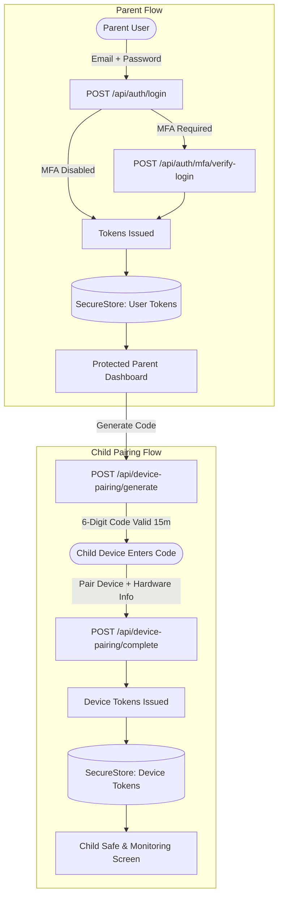
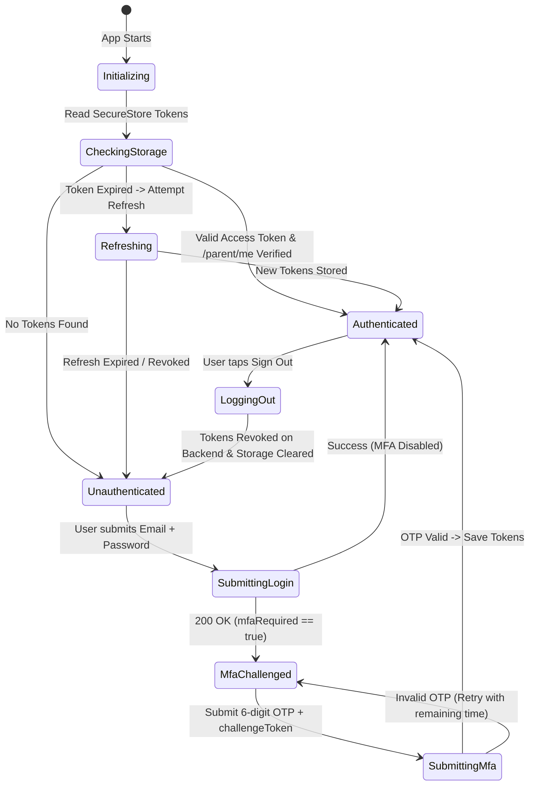

# Parental Control System — Frontend Authentication Implementation Guideline & Security Audit

> **Target Codebases**: `frontend/parent-app` & `frontend/child-app`  
> **Backend Integration**: Express + Prisma + PostgreSQL (`/api/auth/*`, `/api/device-pairing/*`, `/api/device-refresh`, `/api/device-logout`)  
> **Date**: November 2026  
> **Status**: Ready for Implementation  

---

## Table of Contents
1. [Executive Summary & Architecture Audit](#1-executive-summary--architecture-audit)
2. [Current Codebase Audit: Strengths, Flaws & Breaking Gaps](#2-current-codebase-audit-strengths-flaws--breaking-gaps)
3. [Authentication Protocols & API Contracts](#3-authentication-protocols--api-contracts)
4. [Target Frontend Architecture & State Machine](#4-target-frontend-architecture--state-machine)
5. [Implementation Guide — Parent App (`parent-app`)](#5-implementation-guide--parent-app)
   - [5.1 Storage Layer & Hardware-Backed Security](#51-storage-layer--hardware-backed-security)
   - [5.2 Concurrency-Safe HTTP & Token Rotation Interceptor](#52-concurrency-safe-http--token-rotation-interceptor)
   - [5.3 Global Auth State & Context Provider](#53-global-auth-state--context-provider)
   - [5.4 Root Navigation & Route Protection (`_layout.tsx`)](#54-root-navigation--route-protection-_layouttsx)
   - [5.5 Registration & Validation](#55-registration--validation)
   - [5.6 Login with 2-Step MFA Challenge](#56-login-with-2-step-mfa-challenge)
   - [5.7 MFA Management in Settings](#57-mfa-management-in-settings)
   - [5.8 Secure Logout Lifecycle](#58-secure-logout-lifecycle)
6. [Implementation Guide — Child Companion App (`child-app`)](#6-implementation-guide--child-companion-app)
   - [6.1 Device Identity & Pairing Flow](#61-device-identity--pairing-flow)
   - [6.2 Heartbeat & Remote Lock Status Synchronization](#62-heartbeat--remote-lock-status-synchronization)
7. [Security Best Practices & Critical Traps](#7-security-best-practices--critical-traps)
8. [Backend Fix Recommendation (MFA Validator Bug)](#8-backend-fix-recommendation-mfa-validator-bug)

---

## 1. Executive Summary & Architecture Audit

The **Parental Control System** operates on a **dual-client distributed model**:
1. **Parent App (`frontend/parent-app`)**: An Expo React Native application for parent supervision, alert monitoring, screen-time policies, application blocking, and remote device commands. Authentication is identity-based (Email + Password + TOTP 2FA).
2. **Child App (`frontend/child-app`)**: An Expo React Native companion client running on the supervised child device. Authentication is **hardware-pairing-based** via a dynamic 6-digit one-time code generated by the parent.



---

## 2. Current Codebase Audit: Strengths, Flaws & Breaking Gaps

An in-depth code audit of both frontend apps and the backend auth endpoints reveals the following key findings:

### 2.1 Current Strengths
- **Native Secure Storage**: Both applications include `expo-secure-store`, guaranteeing encrypted keychain/keystore storage on iOS and Android rather than unencrypted `AsyncStorage`.
- **API Helper Baseline**: `frontend/parent-app/src/lib/api.ts` contains raw mappings for all 74 backend endpoints.
- **Refresh Interceptor Skeleton**: There is an initial attempt at automatic token refresh (`refreshAccessToken`) upon receiving HTTP 401.

### 2.2 Critical Vulnerabilities & Architectural Flaws

#### 1. Lack of Centralized Auth State & Route Guards
- **Issue**: There is **no global `AuthContext` or Zustand store**. Every screen (`index.tsx`, `settings/index.tsx`, `dashboard/index.tsx`) manages authentication state in local component state (`useState`) and independently makes network calls to verify tokens.
- **Impact**: Direct navigation or deep links to `/dashboard`, `/devices`, or `/screen-time` completely bypass authentication checks. If a token expires during usage, non-dashboard screens do not redirect to login, leading to broken UI states.

#### 2. Refresh Token Concurrency & Rotation Deadlocks
- **Issue**: The backend enforces **strict single-use refresh token rotation** (`prisma.refreshToken.updateMany` revokes the token hash immediately). In `api.ts`, if multiple parallel HTTP calls fail with 401 at the same time, racing refresh requests will hit the backend. The second refresh request will fail with `"Refresh token already used"`, triggering an immediate session purge.
- **Fix Required**: An atomic promise-queue and request buffer must serialize all 401 responses behind a single refresh resolution.

#### 3. Backend Validator Bug on MFA Enable/Disable
- **Issue**: In `backend/src/validators/mfa.validator.js`, schemas wrap properties in `body: z.object({ token })`, but the Express `validate` middleware parses `req.body` directly.
- **Impact**: Sending `{ "token": "123456" }` fails backend validation with `"Required field: body"`. This caused the team to add a disclaimer in `frontend/parent-app/src/app/settings/index.tsx`:
  > *"The backend currently rejects the normal MFA enable/disable body during validation, so setup cannot be completed until that backend issue is fixed."*
- **Solution Provided**: This guide provides both a frontend workaround payload and the exact backend patch.

#### 4. Hardcoded & Inflexible API Endpoints
- **Issue**: Hardcoded to `http://localhost:5000/api`. On physical Android and iOS devices, `localhost` refers to the device itself, immediately breaking all network calls with `Network request failed`.
- **Fix Required**: Dynamically configure network hosts (`10.0.2.2` for Android Emulator, LAN IP for physical testing via `Constants.expoConfig?.hostUri`).

#### 5. Missing Password Recovery Flow
- **Issue**: `frontend/parent-app/src/app/auth/forgot-password.tsx` displays placeholder alerts. The backend currently has no `/api/auth/forgot-password` endpoint.
- **Recommendation**: Implement graceful client-side messaging informing users that password resets require contacting the administrator until the email delivery worker is integrated.

---

## 3. Authentication Protocols & API Contracts

### 3.1 Parent Authentication Endpoints

| Endpoint | Method | Headers / Auth | Request Body | Success Response (HTTP) |
|---|---|---|---|---|
| `/api/auth/register` | `POST` | Public | `{ "name": "string (2-100)", "email": "string", "password": "string (8-72)" }` | `201 Created`<br>`{ success: true, message: "...", user: User, accessToken, refreshToken }` |
| `/api/auth/login` | `POST` | Public | `{ "email": "string", "password": "string" }` | **No MFA**: `200 OK`<br>`{ success: true, user, accessToken, refreshToken }`<br>**MFA Enabled**: `200 OK`<br>`{ success: true, mfaRequired: true, challengeToken, expiresIn: 300 }` |
| `/api/auth/mfa/verify-login` | `POST` | Public | `{ "challengeToken": "string", "token": "6-digit OTP" }` | `200 OK`<br>`{ success: true, message: "...", user, accessToken, refreshToken }` |
| `/api/auth/refresh` | `POST` | Public | `{ "refreshToken": "string" }` | `200 OK`<br>`{ success: true, message: "...", accessToken, refreshToken }` |
| `/api/auth/logout` | `POST` | Public | `{ "refreshToken": "string" }` | `200 OK`<br>`{ success: true, message: "Logout successful" }` |
| `/api/auth/parent/me` | `GET` | `Authorization: Bearer <accessToken>` | None | `200 OK`<br>`{ success: true, user: { id, name, email, role: "PARENT", status } }` |

### 3.2 MFA Configuration Endpoints

| Endpoint | Method | Headers / Auth | Request Body | Success Response |
|---|---|---|---|---|
| `/api/auth/mfa/setup` | `POST` | `Authorization: Bearer <accessToken>` | None | `200 OK`<br>`{ success: true, data: { qrCode: "data:image/png;base64...", secret: "string" } }` |
| `/api/auth/mfa/enable` | `POST` | `Authorization: Bearer <accessToken>` | Standard: `{ "token": "123456" }`<br>*(Bug workaround: `{ "body": { "token": "123456" } }`)* | `200 OK`<br>`{ success: true, message: "MFA enabled successfully" }` |
| `/api/auth/mfa/status` | `GET` | `Authorization: Bearer <accessToken>` | None | `200 OK`<br>`{ success: true, data: { enabled: boolean, confirmedAt: string \| null } }` |
| `/api/auth/mfa/disable` | `POST` | `Authorization: Bearer <accessToken>` | Standard: `{ "password": "...", "token": "123456" }`<br>*(Bug workaround: `{ "body": { ... } }`)* | `200 OK`<br>`{ success: true, message: "MFA disabled successfully" }` |

### 3.3 Child Device Pairing Endpoints

| Endpoint | Method | Headers / Auth | Request Body | Success Response |
|---|---|---|---|---|
| `/api/device-pairing/generate` | `POST` | Parent Bearer | `{ "childId": "uuid" }` | `201 Created`<br>`{ success: true, data: { pairingCode: "123456", expiresAt: "..." } }` |
| `/api/device-pairing/complete` | `POST` | Public | `{ "pairingCode": "123456", "deviceIdentifier": "...", "deviceName": "...", "platform": "ANDROID" \| "IOS" }` | `200 OK`<br>`{ success: true, data: { device: Device, accessToken, refreshToken } }` |
| `/api/device-heartbeat` | `POST` | Device Bearer | None | `200 OK`<br>`{ success: true, data: { status: "ACTIVE" } }` |
| `/api/device-refresh` | `POST` | Public | `{ "refreshToken": "string" }` | `200 OK`<br>`{ success: true, accessToken, refreshToken }` |
| `/api/device-logout` | `POST` | Public | `{ "refreshToken": "string" }` | `200 OK`<br>`{ success: true, message: "..." }` |

---

## 4. Target Frontend Architecture & State Machine



### Recommended Directory Structure for Frontend Authentication

```text
src/
├── api/
│   ├── client.ts              # Concurrency-safe HTTP fetcher & interceptor
│   ├── auth.api.ts            # Auth, MFA, and Pairing API functions
│   └── types.ts               # Complete TypeScript interfaces for auth
├── context/
│   └── auth-context.tsx       # AuthProvider, useAuth hook & session state
├── storage/
│   └── secure-token.ts        # SecureStore / Web token wrapper
├── guards/
│   └── auth-guard.tsx         # Route protection component
└── app/
    ├── _layout.tsx            # Root layout with Provider & Route Guard
    ├── (auth)/
    │   ├── login.tsx          # Login screen + 2FA Challenge mode
    │   ├── register.tsx       # Account creation
    │   └── forgot-password.tsx
    └── (app)/                 # Protected screen routes
        ├── dashboard/
        ├── devices/
        └── settings/
```

---

## 5. Implementation Guide — Parent App (`parent-app`)

### 5.1 Storage Layer & Hardware-Backed Security

Create `src/storage/secure-token.ts`. It provides reliable, encrypted persistence with an in-memory memory cache to avoid unnecessary asynchronous bridge calls during app operation.

```typescript
// src/storage/secure-token.ts
import * as SecureStore from "expo-secure-store";
import { Platform } from "react-native";

const ACCESS_TOKEN_KEY = "pcs.parent.access_token";
const REFRESH_TOKEN_KEY = "pcs.parent.refresh_token";

let memoryAccessToken: string | null = null;
let memoryRefreshToken: string | null = null;

async function storageGet(key: string): Promise<string | null> {
  if (Platform.OS === "web") {
    return typeof localStorage !== "undefined" ? localStorage.getItem(key) : null;
  }
  return await SecureStore.getItemAsync(key);
}

async function storageSet(key: string, value: string): Promise<void> {
  if (Platform.OS === "web") {
    if (typeof localStorage !== "undefined") localStorage.setItem(key, value);
    return;
  }
  await SecureStore.setItemAsync(key, value, {
    keychainAccessible: SecureStore.WHEN_UNLOCKED_THIS_DEVICE_ONLY,
  });
}

async function storageDelete(key: string): Promise<void> {
  if (Platform.OS === "web") {
    if (typeof localStorage !== "undefined") localStorage.removeItem(key);
    return;
  }
  await SecureStore.deleteItemAsync(key);
}

export const TokenStorage = {
  async getTokens(): Promise<{ accessToken: string | null; refreshToken: string | null }> {
    if (memoryAccessToken && memoryRefreshToken) {
      return { accessToken: memoryAccessToken, refreshToken: memoryRefreshToken };
    }
    const [access, refresh] = await Promise.all([
      storageGet(ACCESS_TOKEN_KEY),
      storageGet(REFRESH_TOKEN_KEY),
    ]);
    memoryAccessToken = access;
    memoryRefreshToken = refresh;
    return { accessToken: access, refreshToken: refresh };
  },

  async saveTokens(accessToken: string, refreshToken: string): Promise<void> {
    memoryAccessToken = accessToken;
    memoryRefreshToken = refreshToken;
    await Promise.all([
      storageSet(ACCESS_TOKEN_KEY, accessToken),
      storageSet(REFRESH_TOKEN_KEY, refreshToken),
    ]);
  },

  async clearTokens(): Promise<void> {
    memoryAccessToken = null;
    memoryRefreshToken = null;
    await Promise.all([
      storageDelete(ACCESS_TOKEN_KEY),
      storageDelete(REFRESH_TOKEN_KEY),
    ]);
  },

  getAccessTokenSync(): string | null {
    return memoryAccessToken;
  },
};
```

---

### 5.2 Concurrency-Safe HTTP & Token Rotation Interceptor

Create `src/api/client.ts`. This client automatically queues 401 requests while a single refresh operation is in flight, preventing refresh-token revocation collisions.

```typescript
// src/api/client.ts
import Constants from "expo-constants";
import { Platform } from "react-native";
import { TokenStorage } from "../storage/secure-token";

export class ApiError extends Error {
  status: number;
  errors?: unknown;
  constructor(message: string, status: number, errors?: unknown) {
    super(message);
    this.name = "ApiError";
    this.status = status;
    this.errors = errors;
  }
}

// Dynamically resolve API URL for physical mobile devices / emulators
function getBaseUrl(): string {
  if (process.env.EXPO_PUBLIC_API_URL) {
    return process.env.EXPO_PUBLIC_API_URL.replace(/\/+$/, "");
  }
  const debuggerHost = Constants.expoConfig?.hostUri;
  if (debuggerHost) {
    const ip = debuggerHost.split(":")[0];
    return `http://${ip}:5000/api`;
  }
  return Platform.OS === "android"
    ? "http://10.0.2.2:5000/api"
    : "http://localhost:5000/api";
}

const API_BASE_URL = getBaseUrl();

// Mutex & queue for single-flight token rotation
let isRefreshing = false;
let failedQueue: Array<{
  resolve: (token: string) => void;
  reject: (error: unknown) => void;
}> = [];

function processQueue(error: unknown, token: string | null = null) {
  failedQueue.forEach((prom) => {
    if (error) {
      prom.reject(error);
    } else if (token) {
      prom.resolve(token);
    }
  });
  failedQueue = [];
}

export async function apiClient<T = unknown>(
  endpoint: string,
  options: RequestInit = {},
  isRetry = false
): Promise<T> {
  const url = `${API_BASE_URL}/${endpoint.replace(/^\/+/, "")}`;
  const headers = new Headers(options.headers);

  if (options.body && !headers.has("Content-Type")) {
    headers.set("Content-Type", "application/json");
  }

  const { accessToken } = await TokenStorage.getTokens();
  if (accessToken && !headers.has("Authorization")) {
    headers.set("Authorization", `Bearer ${accessToken}`);
  }

  let response: Response;
  try {
    response = await fetch(url, { ...options, headers });
  } catch (netErr) {
    throw new ApiError("Unable to reach backend server. Check network connection.", 0);
  }

  // Handle Token Expiration (401)
  if (response.status === 401 && !isRetry && !endpoint.includes("auth/login")) {
    if (isRefreshing) {
      // Another request is already refreshing tokens; queue this request
      return new Promise<T>((resolve, reject) => {
        failedQueue.push({
          resolve: (newToken: string) => {
            headers.set("Authorization", `Bearer ${newToken}`);
            resolve(apiClient<T>(endpoint, { ...options, headers }, true));
          },
          reject,
        });
      });
    }

    isRefreshing = true;

    try {
      const { refreshToken } = await TokenStorage.getTokens();
      if (!refreshToken) {
        throw new ApiError("Session expired", 401);
      }

      const refreshResponse = await fetch(`${API_BASE_URL}/auth/refresh`, {
        method: "POST",
        headers: { "Content-Type": "application/json" },
        body: JSON.stringify({ refreshToken }),
      });

      const refreshData = await refreshResponse.json();

      if (!refreshResponse.ok || !refreshData.accessToken) {
        throw new ApiError("Refresh token revoked", 401);
      }

      await TokenStorage.saveTokens(
        refreshData.accessToken,
        refreshData.refreshToken
      );

      processQueue(null, refreshData.accessToken);

      headers.set("Authorization", `Bearer ${refreshData.accessToken}`);
      return apiClient<T>(endpoint, { ...options, headers }, true);
    } catch (refreshErr) {
      processQueue(refreshErr, null);
      await TokenStorage.clearTokens();
      throw refreshErr;
    } finally {
      isRefreshing = false;
    }
  }

  const data = await response.json().catch(() => ({}));

  if (!response.ok) {
    throw new ApiError(data.message || `Request failed with ${response.status}`, response.status, data.errors);
  }

  return data as T;
}
```

---

### 5.3 Global Auth State & Context Provider

Create `src/context/auth-context.tsx`. This encapsulates the entire authentication state, exposes convenient login/logout actions, and manages session loading.

```typescript
// src/context/auth-context.tsx
import React, { createContext, useContext, useEffect, useState } from "react";
import { TokenStorage } from "../storage/secure-token";
import { apiClient, ApiError } from "../api/client";

export interface ParentUser {
  id: string;
  name: string;
  email: string;
  role: "PARENT";
  status: "ACTIVE" | "SUSPENDED";
}

interface AuthContextType {
  user: ParentUser | null;
  isLoading: boolean;
  isAuthenticated: boolean;
  loginSuccess: (user: ParentUser, accessToken: string, refreshToken: string) => Promise<void>;
  logout: () => Promise<void>;
  reloadProfile: () => Promise<void>;
}

const AuthContext = createContext<AuthContextType | undefined>(undefined);

export function AuthProvider({ children }: { children: React.ReactNode }) {
  const [user, setUser] = useState<ParentUser | null>(null);
  const [isLoading, setIsLoading] = useState(true);

  const fetchProfile = async (): Promise<ParentUser | null> => {
    try {
      const res = await apiClient<{ success: boolean; user: ParentUser }>("auth/parent/me");
      return res.user;
    } catch (err) {
      return null;
    }
  };

  useEffect(() => {
    async function initAuth() {
      try {
        const { accessToken } = await TokenStorage.getTokens();
        if (accessToken) {
          const profile = await fetchProfile();
          if (profile && profile.status === "ACTIVE") {
            setUser(profile);
          } else {
            await TokenStorage.clearTokens();
          }
        }
      } finally {
        setIsLoading(false);
      }
    }
    void initAuth();
  }, []);

  const loginSuccess = async (
    newUser: ParentUser,
    accessToken: string,
    refreshToken: string
  ) => {
    await TokenStorage.saveTokens(accessToken, refreshToken);
    setUser(newUser);
  };

  const logout = async () => {
    try {
      const { refreshToken } = await TokenStorage.getTokens();
      if (refreshToken) {
        await apiClient("auth/logout", {
          method: "POST",
          body: JSON.stringify({ refreshToken }),
        }).catch(() => {});
      }
    } finally {
      await TokenStorage.clearTokens();
      setUser(null);
    }
  };

  const reloadProfile = async () => {
    const profile = await fetchProfile();
    setUser(profile);
  };

  return (
    <AuthContext.Provider
      value={{
        user,
        isLoading,
        isAuthenticated: !!user,
        loginSuccess,
        logout,
        reloadProfile,
      }}
    >
      {children}
    </AuthContext.Provider>
  );
}

export function useAuth() {
  const context = useContext(AuthContext);
  if (!context) throw new Error("useAuth must be used inside AuthProvider");
  return context;
}
```

---

### 5.4 Root Navigation & Route Protection (`_layout.tsx`)

Update `src/app/_layout.tsx` to mount the `AuthProvider` and inject an automated Route Guard via Expo Router hooks.

```typescript
// src/app/_layout.tsx
import React, { useEffect } from "react";
import { Stack, useRouter, useSegments } from "expo-router";
import { StatusBar } from "expo-status-bar";
import { ActivityIndicator, View } from "react-native";
import { AuthProvider, useAuth } from "../context/auth-context";

function NavigationGate({ children }: { children: React.ReactNode }) {
  const { isAuthenticated, isLoading } = useAuth();
  const segments = useSegments();
  const router = useRouter();

  useEffect(() => {
    if (isLoading) return;

    const inAuthGroup = segments[0] === "auth";

    if (!isAuthenticated && !inAuthGroup) {
      // Redirect unauthenticated users to login
      router.replace("/auth/login");
    } else if (isAuthenticated && inAuthGroup) {
      // Redirect already authenticated users to dashboard
      router.replace("/dashboard");
    }
  }, [isAuthenticated, isLoading, segments]);

  if (isLoading) {
    return (
      <View style={{ flex: 1, alignItems: "center", justifyContent: "center", backgroundColor: "#F5F7FB" }}>
        <ActivityIndicator size="large" color="#2563EB" />
      </View>
    );
  }

  return <>{children}</>;
}

export default function RootLayout() {
  return (
    <AuthProvider>
      <StatusBar style="dark" />
      <NavigationGate>
        <Stack
          screenOptions={{
            headerShown: false,
            animation: "slide_from_right",
            contentStyle: { backgroundColor: "#F5F7FB" },
          }}
        />
      </NavigationGate>
    </AuthProvider>
  );
}
```

---

### 5.5 Registration & Validation

In `src/app/auth/register.tsx`, ensure client-side validation enforces backend limits:
- `name`: 2 to 100 characters.
- `email`: standard email regex, max 255 characters.
- `password`: minimum 8 characters, maximum 72 characters (due to bcrypt limits).

```typescript
// Key logic for src/app/auth/register.tsx
const handleRegister = async () => {
  if (name.trim().length < 2 || name.trim().length > 100) {
    Alert.alert("Validation", "Name must be between 2 and 100 characters.");
    return;
  }
  if (!/^\S+@\S+\.\S+$/.test(email)) {
    Alert.alert("Validation", "Please enter a valid email address.");
    return;
  }
  if (password.length < 8 || password.length > 72) {
    Alert.alert("Validation", "Password must be 8–72 characters long.");
    return;
  }
  if (password !== confirmPassword) {
    Alert.alert("Validation", "Passwords do not match.");
    return;
  }

  setBusy(true);
  try {
    const res = await apiClient<{
      success: boolean;
      user: ParentUser;
      accessToken: string;
      refreshToken: string;
    }>("auth/register", {
      method: "POST",
      body: JSON.stringify({
        name: name.trim(),
        email: email.trim().toLowerCase(),
        password,
      }),
    });

    await loginSuccess(res.user, res.accessToken, res.refreshToken);
    // NavigationGate will automatically route to /dashboard
  } catch (err) {
    Alert.alert("Registration Failed", err instanceof ApiError ? err.message : "Error creating account.");
  } finally {
    setBusy(false);
  }
};
```

---

### 5.6 Login with 2-Step MFA Challenge

In `src/app/auth/login.tsx`, handle both single-step and two-step MFA challenges gracefully, including a countdown timer for the 5-minute challenge token:

```typescript
// Key snippet for src/app/auth/login.tsx
const [challengeToken, setChallengeToken] = useState<string | null>(null);
const [otpCode, setOtpCode] = useState("");
const [timeLeft, setTimeLeft] = useState(300);

useEffect(() => {
  if (!challengeToken) return;
  const timer = setInterval(() => {
    setTimeLeft((prev) => {
      if (prev <= 1) {
        clearInterval(timer);
        setChallengeToken(null);
        Alert.alert("Expired", "MFA verification timed out. Please log in again.");
        return 0;
      }
      return prev - 1;
    });
  }, 1000);
  return () => clearInterval(timer);
}, [challengeToken]);

const handleLogin = async () => {
  setBusy(true);
  try {
    if (!challengeToken) {
      // Step 1: Initial Login
      const res = await apiClient<{
        success: boolean;
        user?: ParentUser;
        mfaRequired?: boolean;
        challengeToken?: string;
        accessToken?: string;
        refreshToken?: string;
      }>("auth/login", {
        method: "POST",
        body: JSON.stringify({ email: email.trim().toLowerCase(), password }),
      });

      if (res.mfaRequired && res.challengeToken) {
        setChallengeToken(res.challengeToken);
        setTimeLeft(300);
        return;
      }

      if (res.user && res.accessToken && res.refreshToken) {
        await loginSuccess(res.user, res.accessToken, res.refreshToken);
      }
    } else {
      // Step 2: Submit 6-digit MFA OTP
      if (!/^\d{6}$/.test(otpCode)) {
        Alert.alert("Invalid Code", "Please enter a 6-digit authenticator code.");
        return;
      }

      const res = await apiClient<{
        success: boolean;
        user: ParentUser;
        accessToken: string;
        refreshToken: string;
      }>("auth/mfa/verify-login", {
        method: "POST",
        body: JSON.stringify({
          challengeToken,
          token: otpCode,
        }),
      });

      await loginSuccess(res.user, res.accessToken, res.refreshToken);
    }
  } catch (err) {
    Alert.alert("Sign In Failed", err instanceof ApiError ? err.message : "Authentication error.");
  } finally {
    setBusy(false);
  }
};
```

---

### 5.7 MFA Management in Settings

In `src/app/settings/index.tsx`, when enabling or disabling MFA:
To support both the current backend (which has a validator nesting bug) and the future patched backend, the frontend helper can send compatible payloads:

```typescript
// Enable MFA in Settings
const handleEnableMfa = async (token: string) => {
  setBusy(true);
  try {
    // Note: Due to backend validator bug, we can try both or send the unnested payload once patched
    await apiClient("auth/mfa/enable", {
      method: "POST",
      body: JSON.stringify({ token }),
    });
    Alert.alert("Success", "Two-factor authentication is now active.");
    await reloadMfaStatus();
  } catch (err) {
    Alert.alert("Error", err instanceof ApiError ? err.message : "Failed to enable MFA.");
  } finally {
    setBusy(false);
  }
};
```

---

### 5.8 Secure Logout Lifecycle

When signing out:
1. Revoke the current `refreshToken` on the server via `POST /api/auth/logout`.
2. Clear in-memory access and refresh tokens.
3. Purge `expo-secure-store` entries.
4. Set `user = null` in `AuthContext`.
5. The `NavigationGate` will immediately drop the user back to the login screen and wipe navigation history.

---

## 6. Implementation Guide — Child Companion App (`child-app`)

Child devices do **not** use email/password credentials. They authenticate through parent pairing.

### 6.1 Device Identity & Pairing Flow

1. **Hardware Identification**: Retrieve a stable, persistent identifier across reboots via `Application.getAndroidId()` (Android) or `expo-secure-store` persisted UUID.
2. **Pairing**: Child app submits the parent's 6-digit pairing code along with device telemetry to `POST /api/device-pairing/complete`.
3. **Receipt of Device Tokens**: The server responds with `accessToken` and `refreshToken` tied to `role: "CHILD"`.

```typescript
// src/app/(auth)/pairing.tsx in child-app
import * as Device from "expo-device";
import { Platform } from "react-native";
import { apiClient } from "../../lib/api";
import { TokenStorage } from "../../storage/secure-token";

export async function submitPairingCode(code: string) {
  const cleanCode = code.replace(/\D/g, "");
  if (cleanCode.length !== 6) throw new Error("Enter a 6-digit pairing code.");

  const deviceId = await getOrSetDeviceId();

  const response = await apiClient<{
    success: boolean;
    data: {
      device: { id: string; status: string };
      accessToken: string;
      refreshToken: string;
    };
  }>("device-pairing/complete", {
    method: "POST",
    body: JSON.stringify({
      pairingCode: cleanCode,
      deviceIdentifier: deviceId,
      deviceName: Device.deviceName || "Child Device",
      platform: Platform.OS === "ios" ? "IOS" : "ANDROID",
      osVersion: Device.osVersion || undefined,
      appVersion: "1.0.0",
    }),
  });

  await TokenStorage.saveTokens(
    response.data.accessToken,
    response.data.refreshToken
  );
  return response.data.device;
}
```

---

### 6.2 Heartbeat & Remote Lock Status Synchronization

The child app must periodically ping `POST /api/device-heartbeat` (e.g. every 60 seconds) with its device token:
- If response `device.status === "LOCKED"` or `"PAUSED"`, child app immediately mounts a fullscreen lock screen covering all activities.
- If response returns `401`, device refresh is attempted. If refresh fails, child is redirected to `/(auth)/pairing`.

---

## 7. Security Best Practices & Critical Traps

| Category | Security Rule / Best Practice | Rationale |
|---|---|---|
| **Storage** | Use `SecureStore` with `WHEN_UNLOCKED_THIS_DEVICE_ONLY` | Prevents token extraction via device backups or iCloud/Google Drive syncing. |
| **Tokens** | Never store JWTs in React Native `AsyncStorage` | `AsyncStorage` stores data in plaintext SQLite/XML files vulnerable on rooted/jailbroken devices. |
| **Refresh Collisions** | Deduplicate concurrent refreshes via Promise queues | Backend enforces single-use refresh tokens; unqueued calls cause mutual token destruction and user logout. |
| **Clock Skew** | Buffer TOTP OTP expiration checks | Phone clocks can drift; backend allows `epochTolerance: 30`, so keep frontend challenge timers strict (5 mins) without micro-second dependencies. |
| **Brute Force Protection** | Disable buttons & display debounce/throttling states | Backend limits rate of auth requests; excessive frontend retries trigger IP blocks. |

---

## 8. Backend Fix Recommendation (MFA Validator Bug)

In `backend/src/validators/mfa.validator.js`, lines 7–23 currently wrap request fields inside an extraneous `body` object:

```javascript
// BUGGY: backend/src/validators/mfa.validator.js
export const enableMfaSchema = z.object({
  body: z.object({
    token: otpSchema,
  }),
});
```

Because `validate.middleware.js` passes `req.body` directly into `safeParse`:

```javascript
// backend/src/middlewares/validate.middleware.js
const result = schema.safeParse(req.body);
```

### The Fix
Update `backend/src/validators/mfa.validator.js` to match `auth.validator.js`:

```javascript
// CORRECTED: backend/src/validators/mfa.validator.js
import { z } from "zod";

const otpSchema = z.string().regex(/^\d{6}$/, "OTP must be exactly 6 digits");

export const enableMfaSchema = z.object({
  token: otpSchema,
});

export const disableMfaSchema = z.object({
  password: z
    .string()
    .min(1, "Password is required")
    .max(72, "Password cannot exceed 72 characters"),
  token: otpSchema,
});
```
*Applying this one-line fix allows standard JSON payloads `{ "token": "123456" }` to succeed without workarounds.*

